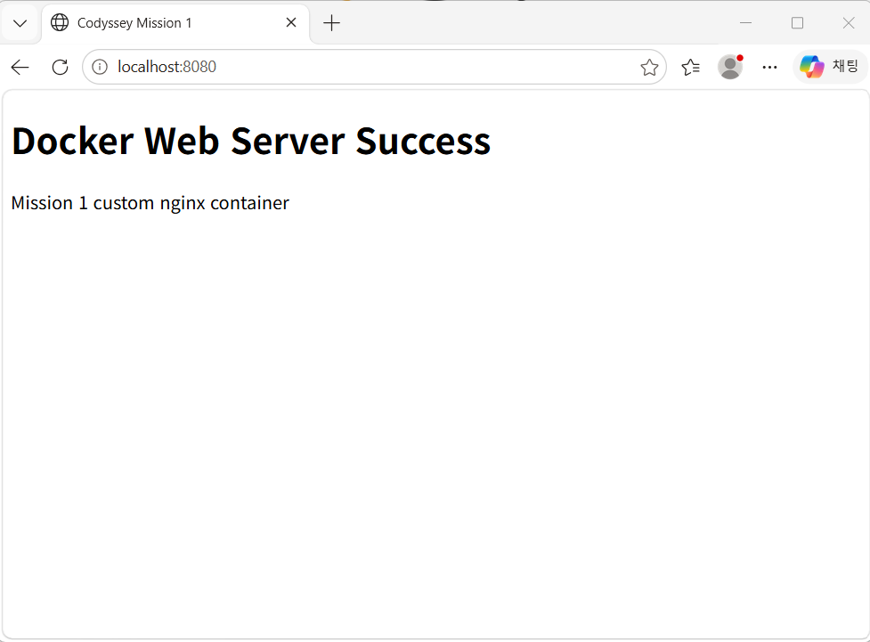
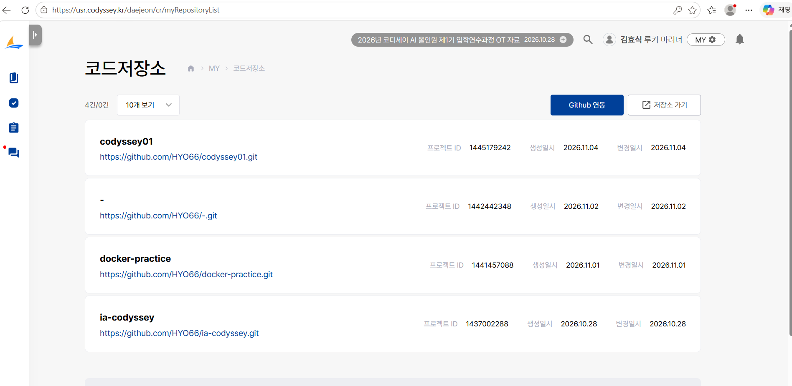
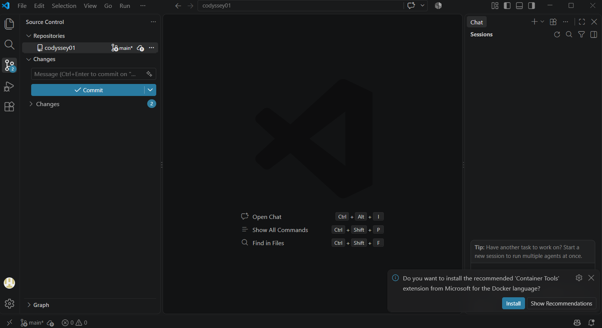

# 개발 워크스테이션 구축 미션

## 1. 프로젝트 개요
이번 미션의 목표는 터미널 사용, 파일 권한, Docker 설치 및 운영, Dockerfile 기반 커스텀 이미지 제작, 포트 매핑, 바인드 마운트, Docker 볼륨, Git/GitHub 연동까지 개발 워크스테이션의 기본 요소를 직접 실습하고 검증하는 것이다.

---

## 2. 실행 환경
- OS: Windows + WSL Ubuntu 26.04.1 LTS
- Shell/Terminal: PowerShell 5 / WSL bash
- VS Code: 1.144.0
- Docker Desktop: 29.9.2
- Git: 2.56.0

---

## 3. 수행 항목 체크리스트
- [O] 터미널 기본 조작 및 폴더 구성
- [O] 파일 권한 변경 실습
- [O] Docker 설치/점검
- [O] hello-world 실행
- [O] ubuntu 컨테이너 내부 명령 실행
- [O] Dockerfile 기반 커스텀 이미지 제작
- [O] 포트 매핑 접속 확인
- [O] 바인드 마운트 반영 확인
- [O] Docker 볼륨 영속성 확인
- [O] Git 설정 및 GitHub/VSCode 연동

---

1.터미널 기본 조작 로그

상세 로그: [docs/logs/terminal.md](./docs/logs/terminal.md)

실행한 주요 명령:
```powershell```  
Get-Location  
Get-ChildItem -Force  
mkdir cli-test  
Set-Location cli-test  
New-Item -ItemType File empty.txt  
Set-Content empty.txt "hello world"  
Get-Content empty.txt  
Copy-Item empty.txt copy.txt  
Move-Item copy.txt renamed.txt  
Set-Location ..  
Remove-Item cli-test -Recurse -Force

---

2.권한 실습 로그

상세 로그: [docs/logs/terminal.md](./docs/logs/terminal.md)

실행한 주요 명령:
```Ubuntu```  
mkdir -p ~/permission-test  
cd ~/permission-test

touch sample.txt  
mkdir sampledir  

ls -ld sample.txt sampledir  

chmod 644 sample.txt  
chmod 755 sampledir  
ls -ld sample.txt sampledir  

chmod 600 sample.txt  
chmod 700 sampledir  
ls -ld sample.txt sampledir

r = 읽기  
w = 쓰기  
x = 실행  
644 = 소유자 rw-, 그룹 r--, 기타 r--    
755 = 소유자 rwx, 그룹 r-x, 기타 r-x

---

3.Docker 설치/점검 로그

상세 로그: [docs/logs/docker.md](./docs/logs/docker.md)

실행한 주요 명령:  
```powershell```  
docker --version  
docker info  
docker images  
docker ps  
docker ps -a

---

4.hello-world / ubuntu 실습 로그

상세 로그: [docs/logs/terminal.md](./docs/logs/terminal.md)

실행한 주요 명령:  
```powershell```  
docker run --name hello-test hello-world  
docker run -it --name ubuntu-test ubuntu bash  
ls  
echo hello from ubuntu container  
exit  
docker ps -a  

attach: 실행 중인 컨테이너의 기본 프로세스에 직접 붙음
exec: 실행 중인 컨테이너 안에서 새 명령을 실행함
실습에서는 exec가 관리와 디버깅에 더 편리했음

---

5.Dockerfile 기반 커스텀 이미지 제작 / 포트매핑 접속 확인

상세 로그: [docs/logs/terminal.md](./docs/logs/terminal.md)

실행한 주요 명령:
```powershell```  
docker build -t my-nginx:1.0 .  
docker run -d --name my-nginx-web -p 8080:80 my-nginx:1.0  
docker ps  
docker logs my-nginx-web  
http://localhost:8080


*포트충돌 문제 해결
 >처음에는 아래 명령으로 실행을 시도.  
   docker run -d --name my-nginx-web -p 8080:80 my-nginx:1.0  

 >이때 다음과 같은 에러가 발생했다.  
   Bind for 0.0.0.0:8080 failed: port is already allocated  

 >원인: 기존에 실행 중이던 다른 nginx 컨테이너가 이미 호스트의 8080 포트를 사용하고 있었기 때문이다  

 >해결책: 기존 8080 컨테이너를 중지 및 제거하고 새 컨테이너 실행  
  docker ps  
  docker stop mynginx
  docker rm mynginx
  docker ps -a
  docker rm -f my-nginx-web
  docker run -d --name my-nginx-web -p 8080:80 my-nginx:1.0

---

6.바인드 마운트 반영 확인

상세 로그: [docs/logs/terminal.md](./docs/logs/terminal.md)

실행한 주요 명령:
```powershell```  
docker run -d --name bind-test -p 8082:80 -v ${PWD}\app:/usr/share/nginx/html nginx

*컨테이너 중복 및 포트충돌 문제 해결
 >먼저 아래 명령으로 실행했다.
  docker run -d --name bind-test -p 8080:80 -v ${PWD}\app:/usr/share/nginx/html nginx  

 >이때 다음과 같은 에러가 발생했다.
  bind-test" is already in use by container  

 >원인: bind-test라는 이름의 컨테이너가 이미 존재해서 같은 이름을 다시 쓸 수 없는 상태  

 >해결책: 기존 컨테이너 삭제 후 다시 실행
  docker rm -f bind-test
  docker run -d --name bind-test -p 8080:80 -v ${PWD}\app:/usr/share/nginx/html nginx  

 >하지만 아직 문제가 완전히 해결되지 않았다.
  failed: port is already allocated  

 >원인: 기존 bind-test가 아직 8080 포트를 사용중이었기 때문이다.  

 >해결책: 이번엔 포트를 바꿔서 해결했다.
  docker run -d --name bind-test -p 8082:80 -v ${PWD}\app:/usr/share/nginx/html nginx

---

7.Docker 볼륨 영속성 확인

상세 로그: [docs/logs/terminal.md](./docs/logs/terminal.md)

실행한 주요 명령: 
```powershell```  
docker volume create mydata  
docker run -d --name vol-test -v mydata:/data ubuntu sleep infinity  
docker exec -it vol-test bash -lc "echo hello-volume > /data/hello.txt && cat /data/hello.txt"  
docker rm -f vol-test  
docker run -d --name vol-test2 -v mydata:/data ubuntu sleep infinity  
docker exec -it vol-test2 bash -lc "cat /data/hello.txt"

---

8.Git연동 확인

상세 로그: [docs/logs/terminal.md](./docs/logs/terminal.md)

실행한 주요 명령:
```powershell```  
git config --global user.name  
git config --global user.email  
git config --global init.defaultBranch  
git config --list

---

9.GitHub/VSCode 연동





**트러블 슈팅

참고: 사전 학습 과정에서 같은 과정을 진행했다 보니 충돌이 자주 발생함.

*포트충돌 문제 해결
 >처음에는 아래 명령으로 실행을 시도.  
   docker run -d --name my-nginx-web -p 8080:80 my-nginx:1.0  

 >이때 다음과 같은 에러가 발생했다.  
   Bind for 0.0.0.0:8080 failed: port is already allocated  

 >원인: 기존에 실행 중이던 다른 nginx 컨테이너가 이미 호스트의 8080 포트를 사용하고 있었기 때문이다  

 >해결책: 기존 8080 컨테이너를 중지 및 제거하고 새 컨테이너 실행  
  docker ps  
  docker stop mynginx
  docker rm mynginx
  docker ps -a
  docker rm -f my-nginx-web
  docker run -d --name my-nginx-web -p 8080:80 my-nginx:1.0

*컨테이너 중복 및 포트충돌 문제 해결
 >먼저 아래 명령으로 실행했다.
  docker run -d --name bind-test -p 8080:80 -v ${PWD}\app:/usr/share/nginx/html nginx  

 >이때 다음과 같은 에러가 발생했다.
  bind-test" is already in use by container  

 >원인: bind-test라는 이름의 컨테이너가 이미 존재해서 같은 이름을 다시 쓸 수 없는 상태  

 >해결책: 기존 컨테이너 삭제 후 다시 실행
  docker rm -f bind-test
  docker run -d --name bind-test -p 8080:80 -v ${PWD}\app:/usr/share/nginx/html nginx  

 >하지만 아직 문제가 완전히 해결되지 않았다.
  failed: port is already allocated  

 >원인: 기존 bind-test가 아직 8080 포트를 사용중이었기 때문이다.  

 >해결책: 이번엔 포트를 바꿔서 해결했다.
  docker run -d --name bind-test -p 8082:80 -v ${PWD}\app:/usr/share/nginx/html nginx

